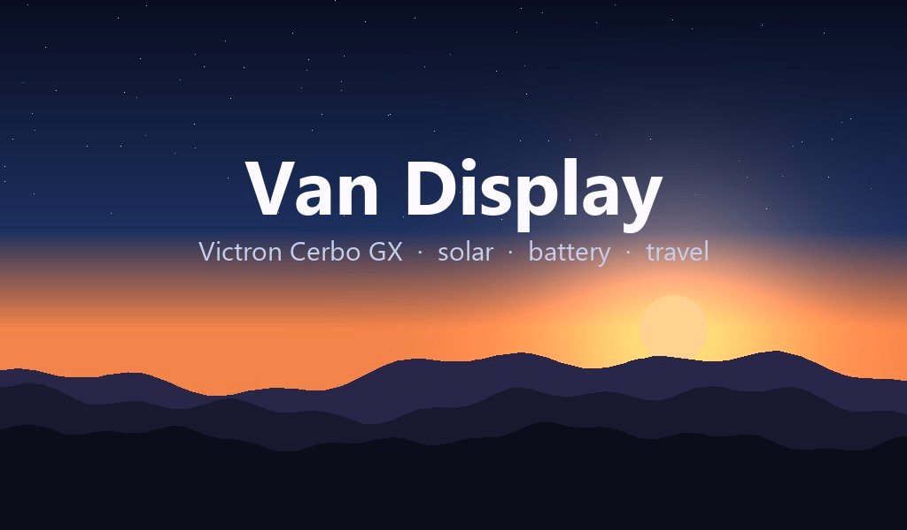
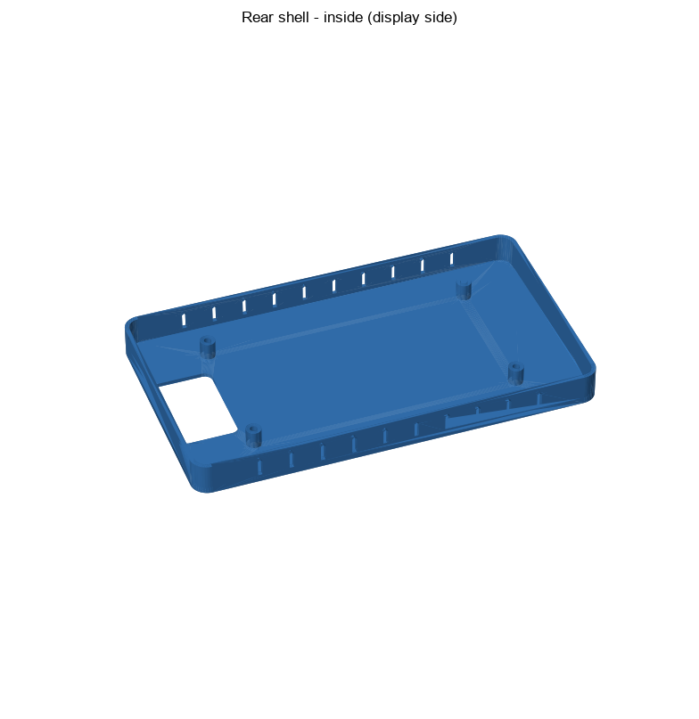

# Van Display: a Victron Cerbo GX touchscreen for your caravan, RV or camper



A 7" touchscreen dashboard for a van with a **Victron Cerbo GX**, built on the
**Waveshare ESP32-S3-Touch-LCD-7B**. It connects to the Cerbo over WiFi and reads everything from
the Cerbo's built-in MQTT broker, so you install nothing on the Cerbo. It shows a Victron-style
power overview, solar detail, a GPS travel map and settings. There's an optional Bluetooth bridge
for a **Projecta Intelli-RV PM335** power manager (water tanks, water pump, hot water).

> **This is a starting point, not a finished product.** The code comes from a display that runs
> every day in one caravan, so its screens match that van's Victron gear and sensor names. Your
> van will be different. The idea is that you open this project in **Claude Code** (Anthropic's AI
> coding tool) and have Claude adapt it to your own setup. You don't need to be a programmer.
> Most of this README explains how to do that.

---

## Contents

1. [What it shows](#what-it-shows)
2. [What you need](#what-you-need)
3. [How it works](#how-it-works)
4. [Step 1: Prepare your Cerbo](#step-1-prepare-your-cerbo)
5. [Step 2: Set up your PC](#step-2-set-up-your-pc)
6. [Step 3: Make it yours with Claude](#step-3-make-it-yours-with-claude)
7. [Prompt cookbook](#prompt-cookbook)
8. [Tips for working with Claude](#tips-for-working-with-claude)
9. [Building and flashing by hand](#building-and-flashing-by-hand)
10. [Optional extras](#optional-extras)
11. [Troubleshooting](#troubleshooting)
12. [Project layout](#project-layout)
13. [Sharing your version](#sharing-your-version)
14. [Licence and disclaimer](#licence-and-disclaimer)

---

## What it shows

| Page | What's on it |
|---|---|
| **Overview** | Solar, DC-DC charger (Orion) and a 240 V charger flowing into the battery; battery %, volts, amps and time to go; DC loads; a "Net" positive/negative indicator; temperature sensors. |
| **Solar** | A card for each MPPT solar charger and a 7-day yield chart. |
| **Travel** | An OpenStreetMap map centred on the Cerbo's GPS position, plus an optional trip summary (odometer, last trip, service due) fed by Node-RED. Map tiles load in the background while another page is showing, so the map is ready when you open it. |
| **Settings** | Theme (Dark / Day / Auto), brightness, screen-off timer, travel safety switch (Projecta option), overnight schedule with touch-to-peek, WiFi choice, device info, firmware version, Check for update. |
| **Header** | Page tabs, internet source (home / Starlink / 4G carrier, worked out from the public IP), WiFi network (tap to pick one) and clock. |
| **Alarm overlay** | A Cerbo digital input in alarm (e.g. a smoke alarm) takes over the screen and wakes it. |
| **Boot splash** | A full-screen picture for 5 seconds at power-up. Swap in a photo of your own van. |
| **Web page** | `http://van-display.local`: health, settings, and firmware upload over WiFi (no cable needed after the first flash). |

With the Projecta option turned on, the Overview also shows water tank levels and Hot water /
Water pump buttons, and the web page gets a PM335 card. **Travel safety** (on by default, switch on
the Settings page) then turns the water pump and hot water off once the Cerbo's GPS shows the van
has really moved (more than 350 m from where it was parked, for 30 seconds), so you don't drive off
with them running.

Optionally, if you run **Home Assistant**, the display can update itself from a build you publish
there: see [`homeassistant/README.md`](homeassistant/README.md).

The display finds Victron devices **by their name** (the custom name you gave them on the Cerbo),
not by instance numbers. Which devices exist, what they're called, and which ones matter to you is
exactly what Claude adapts for your van.

## What you need

| | |
|---|---|
| **Display** | Waveshare **ESP32-S3-Touch-LCD-7B** (1024x600, ESP32-S3 with 16 MB flash and 8 MB PSRAM). Make sure it's the **7B**: other Waveshare 7" boards use different pins, and other brands would need the board layer rewritten. |
| **Victron** | A **Cerbo GX** (or another Venus OS GX device, e.g. Ekrano GX or a Raspberry Pi running Venus OS) on WiFi. Venus OS 3.x. |
| **WiFi** | The display and the Cerbo on the same network: the van's router, the Cerbo's own hotspot, or your home WiFi when the van's parked at home. |
| **PC** | Windows is easiest (the helper script is PowerShell). macOS and Linux work too, using `idf.py` directly. Plus a USB-C data cable. |
| **Software** | [ESP-IDF v5.5](https://docs.espressif.com/projects/esp-idf/en/v5.5/esp32s3/get-started/) (Espressif's free toolkit), [Claude Code](https://claude.com/claude-code) (needs a Claude subscription that includes Claude Code), and optionally [git](https://git-scm.com/). |
| **Optional** | A Projecta Intelli-RV PM335, a GPS on the Cerbo (for the map), Node-RED on the Cerbo (Venus OS Large, for the trip summary), a 3D printer (for the enclosure). |

## How it works

```
                        WiFi
  +-------------+   MQTT, port 1883    +------------------------------+
  |  Cerbo GX   | <------------------> |  Van Display (ESP32-S3, 7")  |
  |  Venus OS   |   N/<portal>/...     |                              |
  +-------------+                      |  Overview  Solar  Travel  ⚙  |
     |  VE.Direct / VE.Can / BT        +------------------------------+
     |  battery monitor, MPPTs,              |            |
     |  DC-DC, inverter, sensors,            | Bluetooth  | internet (optional)
     |  GPS, digital inputs                  v            v
     |                               Projecta PM335   OpenStreetMap tiles,
     |  Node-RED (optional):         (optional)       ip-api.com (ISP name),
     +- VanDisplay/travel JSON                        pool.ntp.org (clock)
```

- The Cerbo publishes every value from every Victron device on its MQTT broker (topics like
  `N/<portal id>/battery/279/Soc`). The display subscribes, keeps the broker awake with a
  keepalive, and matches devices by service type and name.
- WiFi "follows the Cerbo": you list your networks in priority order, each with the Cerbo's IP on
  that network. If the Cerbo doesn't answer on a network, the display moves on to the next one.
- It's written in C with [ESP-IDF](https://github.com/espressif/esp-idf) and
  [LVGL 9](https://lvgl.io/), split into a board layer, a WiFi layer, a Cerbo data layer, and the
  UI pages.
- Your WiFi passwords and web login go in `firmware/main/secrets.h`, which is never committed to
  git. That's also why there's no ready-made firmware file to download: you build your own, with
  your settings in it.

---

## Step 1: Prepare your Cerbo

1. **Turn on MQTT.** On the Cerbo (the touchscreen, Remote Console, or VRM > Remote Console):
   **Settings > Services > MQTT** (newer Venus OS versions call the menu Settings > Integrations).
   Turn on MQTT with plaintext access, port 1883. The display uses only this.
2. **Find the Cerbo's IP address** on each network the display will use: Settings > Ethernet /
   WiFi on the Cerbo, or your router's client list. A fixed IP (a DHCP reservation in the router)
   saves trouble later.
3. **Name your devices.** In the Cerbo's device list, give each device a clear custom name, for
   example temperature sensors "Outside", "Fridge", "Bedroom" and chargers "Roof solar",
   "Portable panel". The display shows these names, and Claude uses them to find your devices.
4. **Write down your gear**, or take photos of the Cerbo's device list. Claude will ask about it:
   - battery monitor (SmartShunt, BMV, Lynx Shunt, a lithium battery's own BMS, ...)
   - solar chargers (how many MPPTs, and their names)
   - DC-DC charger (Orion XS / Orion Smart)
   - inverter/charger (MultiPlus, Quattro, Phoenix) or a separate AC charger
   - temperature, tank and other sensors (Ruuvi, Mopeka, GX Tank, ...)
   - a GPS, and whether anything is wired to the digital inputs (smoke alarm, door, ...)

## Step 2: Set up your PC

1. **Install ESP-IDF v5.5.** On Windows, use Espressif's
   [installer](https://dl.espressif.com/dl/esp-idf/) with the default paths (`C:\Espressif`). The
   build script expects `C:\Espressif\tools\Microsoft.v5.5.5.PowerShell_profile.ps1`. If you install
   a different 5.5.x version, Claude can fix that line in `tools/build.ps1` for you.
2. **Install Claude Code.** Either the Claude desktop app (its **Code** tab) or the command-line
   version: see [claude.com/claude-code](https://claude.com/claude-code).
3. **Get this project.** Either click **Code > Download ZIP** on GitHub and unzip it (for example
   to `C:\Projects\Van Display`), or, with git:

   ```bash
   git clone https://github.com/pazu86/cerbo-gx-van-display.git
   ```

   Use git if you can. It lets Claude (and you) undo a change that didn't work.
4. **Plug in the display.** It has two USB-C ports. Use the one labelled **"USB"** (not
   "UART1"). In Windows Device Manager it shows up as a COM port: note the number.

## Step 3: Make it yours with Claude

### Open the project

Open the project folder in Claude Code: in the desktop app, start a new Code session on the
folder; on the command line, `cd` into it and run `claude`.

Claude reads [`CLAUDE.md`](CLAUDE.md) automatically. It's the project's handover note, written
for Claude: the board's hardware quirks, memory limits, how the Cerbo data works, and the rules
that took weeks to learn on the real hardware. It also tells Claude that you're new to the
project and that it should ask about your van first. **Don't delete it.** Ask Claude to add to it
as you learn things about your own setup.

### Your first prompt

Copy this, fill in the brackets, and send it:

> Read CLAUDE.md and README.md. I want to set this display up for my van.
>
> - My Victron gear: [e.g. Cerbo GX, SmartShunt, two MPPT 100/30s named "Roof" and "Portable",
>   an Orion XS DC-DC, a MultiPlus 12/2000, three Ruuvi tags named Outside, Fridge and Inside,
>   a Mopeka gas sensor]
> - My WiFi: [e.g. the van has a Starlink router "VanNet"; at home it's "HomeWifi"]
> - Cerbo IP: [e.g. 192.168.1.20 on VanNet, 192.168.0.50 at home]
> - Projecta power manager: [no / yes, a PM335]
> - ESP-IDF: [installed / not yet]. Display is on COM[5].
>
> Start by helping me get the first build onto the display with my WiFi, then we'll change the
> screens to match my gear one step at a time.

Claude will:

1. Ask anything it still needs to know.
2. Create `firmware/main/secrets.h` with your networks. Claude needs your WiFi passwords to
   write that file. If you'd rather not paste passwords into the chat, ask Claude to write it
   with placeholders and fill them in yourself.
3. Set the header title and hostname (`idf.py menuconfig`, or it edits `sdkconfig` for you).
4. Build and flash it over USB, and ask you what the screen shows.

**Claude asks before running commands or changing files.** Read what it wants to do and approve
it. You can allow common commands (like the build script) permanently when it asks.

### Let Claude see your Cerbo's data

This is the most useful step. If your PC is on the same network as the Cerbo, Claude can
look at the live data itself instead of guessing topic names:

> My Cerbo is at 192.168.1.20 with MQTT on. Write a small Python script that connects to it,
> sends the keepalive, and lists every device (service type, instance, custom name / product
> name) and the main values you can see. Then compare that with what cerbo.c and
> page_overview.c expect and tell me what needs changing for my van.

Claude will want to install a Python MQTT library (`paho-mqtt`). The script only reads. If your PC
can't reach the Cerbo, send screenshots of the Cerbo's device list instead, or install
[MQTT Explorer](https://mqtt-explorer.com/), connect it to the Cerbo, and paste what you see.

### The working loop

From here, build the display up in small steps:

1. **Ask for one change.** "Show my two MPPTs by name on the Solar page", "Add a gas tank tile".
2. **Claude edits the code and builds it.** After the first USB flash, updates go over WiFi:
   Claude runs `.\tools\build.ps1 ota` and watches the display restart.
3. **Look at the screen and report back.** Say what's wrong, or **send a photo**. Claude can read
   photos and will spot layout problems, wrong numbers and clipped text.
4. **When it's right, commit it.** "That works, commit it." You can always get back to a version
   that worked.

Don't ask for ten things at once. One change you've checked on the screen beats five you haven't.

---

## Prompt cookbook

Starting points to copy and adapt. Mention your device names and what you see.

**Getting going**

- "Set the header title to 'Wanderer' and the hostname to `wanderer-display`."
- "My Cerbo IP changes. Help me set a DHCP reservation, or make the display find the Cerbo itself."
- "Bump the version to 1.1.0, build, update over WiFi and tag it."

**Overview page**

- "My temperature sensors are called Outside, Fridge, Freezer and Cabin. Show them in that order,
  and hide any others."
- "I have a MultiPlus. Read the AC input and AC loads from the Cerbo and show a real charger and an
  AC loads card instead of the inferred 240 V charger."
- "Show my Mopeka gas bottle level from `tank/+` as a tile on the Overview."
- "My battery is a lithium with its own BMS on VE.Can. Use it for state of charge, and show cell
  min/max voltage and BMS alarms."
- "I don't have a DC-DC charger. Remove the Orion and make the solar card bigger."
- "Show a warning banner when the battery is below 30 %."

**Other pages**

- "Add a page for my water and grey tanks from the Cerbo, with big bar gauges."
- "Add a Generator page: running state, hours and a start/stop button through the Cerbo's
  generator relay. Ask me before you send any command, and I'll test it myself."
- "Show the 30-day solar yield on the Solar page instead of 7 days."
- "Make the Travel map default to a zoom level that shows my whole region."

**Look and feel**

- "Use Fahrenheit, and show tank levels in gallons."
- "Make the numbers on the Overview bigger. I read it from across the van."
- "Change the theme colours to match Victron's blue."
- "Here's a photo of my van: make it the boot splash." (Put the picture in `assets/` first.
  [`tools/make_splash.py`](tools/make_splash.py) converts it.)

**Alarms and power saving**

- "My smoke alarm is on digital input 1. Make sure the alarm overlay shows it with a loud colour."
- "Wake the screen and show a warning when the battery drops below 20 %, even overnight."

**When something's wrong**

- "The screen is black after flashing." (See [Troubleshooting](#troubleshooting). Claude knows
  the board's quirks from CLAUDE.md.)
- "Open the serial monitor and tell me why it keeps restarting."
- "The battery amps are showing the wrong sign. Check the raw MQTT value for me."
- "That last change broke the Solar page. Undo it."

## Tips for working with Claude

- **Be specific about what you see.** "The fridge temperature shows 0.0 and it's actually 4 °C"
  is much more useful than "temps are wrong". A photo is better still.
- **Ask why.** Claude will explain the code, the Cerbo's MQTT topics, or what a setting does.
- **Let it read logs.** With the display on USB, Claude can open the serial monitor and read
  what the firmware says. The web page's `/api/health` also shows memory, uptime and the update
  state.
- **Commit working versions.** Ask Claude to commit after each change you're happy with, and to
  bump the version (shown on the Settings page) when you update the display.
- **Keep secrets out of git and out of anything you share.** `secrets.h` is git-ignored. Don't
  paste it into issues or forum posts.
- **Teach it your van.** When you learn something (a device's odd name, a sensor that
  reports in a strange unit), ask Claude to add it to `CLAUDE.md`. Every future session starts
  with that knowledge.
- **Real equipment needs real care.** The display can switch loads (with the Projecta option,
  or anything you add). Test switching yourself, at the van. Don't let any tool switch a pump,
  heater or the van's power when nobody's watching it. `CLAUDE.md` already tells Claude this.
- **Long sessions.** If a session gets long or wanders, start a fresh one. `CLAUDE.md` and git
  carry everything that matters.
- **Memory is tight on this board.** If Claude warns that a feature uses too much internal RAM,
  listen. It's the board's main limit, and CLAUDE.md explains the workarounds.

---

## Building and flashing by hand

You don't need Claude for this part. These are the commands Claude runs.

**First time:**

1. Copy `firmware/main/secrets.example.h` to `firmware/main/secrets.h` and fill in your WiFi
   network(s), the Cerbo's IP on each, and a web password.
2. Optional settings: in an ESP-IDF terminal, in `firmware/`, run `idf.py menuconfig` and open
   **Van Display** (title, hostname, time zone) and **Projecta PM335** (off by default).
3. Build and flash over USB (Windows PowerShell, from the project folder):

   ```powershell
   $env:DISPLAY_PORT = 'COM5'          # your COM port
   .\tools\build.ps1 flash monitor     # Ctrl+] leaves the monitor
   ```

**After that, update over WiFi:**

```powershell
.\tools\build.ps1 ota
```

It uploads the firmware to the display's web API, then follows the restart until the new
firmware confirms itself. If `van-display.local` doesn't resolve, set `$env:DISPLAY_HOST` to the
display's IP (shown on its Settings page).

**macOS / Linux:** in an ESP-IDF shell, from `firmware/`:

```bash
idf.py build
idf.py -p /dev/ttyACM0 flash
python -m esptool --chip esp32s3 -p /dev/ttyACM0 --before no_reset --after watchdog_reset chip_id
curl -u admin:yourpassword --data-binary @build/van_display.bin -H 'Content-Type: application/octet-stream' http://van-display.local/api/ota
```

The `esptool` line restarts the board through its watchdog: a normal reset would leave it in
download mode with a black screen (see [Troubleshooting](#troubleshooting)). The last line is
the WiFi update. Or ask Claude to write a shell version of `build.ps1`.

**Time zone:** menuconfig > Van Display > Time zone takes a POSIX TZ string. The default is
Brisbane (`AEST-10`). The help text there lists other examples.

**Web API** (HTTP basic auth, login from `secrets.h`):

| | |
|---|---|
| `GET /api/health` | firmware version, uptime, memory, WiFi, Cerbo status, update and self-update state, travel safety (`motion`) |
| `GET/POST /api/settings` | the Settings page values |
| `POST /api/ota` | upload new firmware (raw `.bin` body) |
| `POST /api/restart` | restart |
| `POST /api/update/check` | check Home Assistant for a newer build now (self-update) |
| `GET/POST /api/pm335` | Projecta status and setup (when enabled) |

## Optional extras

### Boot splash

At power-up the display shows `firmware/main/splash/splash.jpg` for 5 seconds (a tap skips it).
To use your own picture:

```bash
pip install pillow numpy
python tools/make_splash.py assets/my-van.jpg --anchor 0.6
```

It scales and crops the picture to 1024x600 (`--anchor` picks which part of the height to keep:
0 = top, 1 = bottom), writes the JPEG the firmware embeds, and writes a `splash.preview.png` showing
how it will look on the panel. Rebuild and update.

### Projecta Intelli-RV PM335 (Bluetooth)

If you have a Projecta PM335:

1. Turn it on in menuconfig: **Projecta PM335** > enable, and set its Bluetooth address (the
   IntelliJay app shows it, or scan with nRF Connect).
2. Close the phone app. The PM335 accepts one Bluetooth connection at a time.
3. Give the display the login once, through the web API. The password is the app's pairing key
   shown on the Projecta screen. It's stored on the display, not in the code:

   ```
   POST http://van-display.local/api/pm335   (basic auth)
   {"login":{"user":"user","password":"<pairing key>"},"ctl_addr":"000b00","enabled":true}
   ```

   `ctl_addr` is the load controller's address. Ask Claude to read the device tree and confirm it
   on your unit.

The protocol was reverse-engineered from the phone app's Bluetooth traffic. The write-up is a
Claude skill in [`.claude/skills/projecta-pm335-ble/`](.claude/skills/projecta-pm335-ble/SKILL.md),
which Claude Code loads automatically when it's relevant. Other models (PM200/300/400) probably work
the same way, but their property map may differ. The skill explains how to capture and decode your
own unit's traffic.

**Travel safety** then watches the GPS: once the van has moved more than 350 m from where it sat
still, for 30 seconds, it switches off the pump and hot water if they're on (for 90 seconds, then
again after every further 350 m). Switching the pump back on at a stop is left alone. Needs a GPS
on the Cerbo; turn it off on the Settings page if you don't want it. `/api/health` shows what it
sees under `motion`.

**Caution:** the pump, the hot water and the van's power are real loads. Test with someone at the
van. Running hot water without the pump, or switching off the 12 V that powers the display, are
easy mistakes. Van power is deliberately web-only and Off-only.

### Trip summary (Node-RED)

The Travel page's map works on its own if the Cerbo has a GPS. The trip summary underneath
(odometer, service due, last trip, monthly km) comes from Node-RED on the Cerbo, published as JSON on
the Cerbo's broker under `VanDisplay/travel`. [`nodered/`](nodered/) holds a small flow that reads
a GPS travel logger's `state.json` / `trips.json` and publishes that summary. Edit `DIR`, `BROKER` and
`UTC_OFFSET` at the top of `nodered/build_feed_flow.py`, run it, and import `display-feed.json`.
Without a travel logger, ask Claude to adapt the flow, or hide the summary.

Anything else you publish under `VanDisplay/...` on the Cerbo's broker can be shown on the
display too. Ask Claude.

### Enclosure

[`enclosure/`](enclosure/) has a 3D-printable rear shell with a flat back for a Quad Lock
adhesive mount: STEP (to edit in CAD), STL (to print) and the parametric CadQuery source. See
[`enclosure/README.md`](enclosure/README.md) for printing and fitting. Measure your unit before
printing.



### Self-update from Home Assistant

Build on your PC, run `.\tools\build.ps1 ha`, and the display installs the new firmware by itself
the next time it checks (a minute after joining a network, then every 30 minutes, never while
the van is moving), even when the van is away from home. Needs a small custom component in
Home Assistant, included in [`homeassistant/`](homeassistant/): setup steps in
[`homeassistant/README.md`](homeassistant/README.md). Off unless you set it up.

---

## Troubleshooting

| Problem | What to do |
|---|---|
| **Screen black after flashing, replugging or pressing RESET** | Unplug the display for **30 seconds**, then plug it back in. This is a board quirk (the BOOT pin doubles as a display data line), not a broken build. Software restarts and WiFi updates don't have this problem. |
| Crashes over and over | Hold **BOOT**, press **RESET**, release BOOT, then flash over USB. Ask Claude to read the serial log first. |
| Backlight or brightness acts strangely | Power-cycle it. The IO expander that drives the backlight keeps its state across resets. |
| "Cerbo: no data" | Is MQTT on in the Cerbo's settings? Is the Cerbo's IP in `secrets.h` right for that network? Can your PC reach it (`ping`)? |
| No COM port appears | Use the port labelled **"USB"**, and a data cable (some USB-C cables only charge). |
| `van-display.local` doesn't resolve | Use the IP from the Settings page: `$env:DISPLAY_HOST = '192.168.1.x'`. |
| OTA says 409 / refused | The display is still confirming the previous update. Wait a minute. |
| Settings says "Updates: couldn't reach Home Assistant" | Check `DISPLAY_HA_URL` in `secrets.h` opens in a browser, and that HA was restarted after adding `van_display_update`. Only matters if you set up self-update. |
| Map stays grey | Map tiles need internet. Check the header's internet indicator, and that the Cerbo has a GPS fix. |
| Build can't find ESP-IDF | Check the profile path near the top of `tools/build.ps1` matches your ESP-IDF version. |

## Project layout

```
firmware/                    ESP-IDF project (ESP-IDF 5.5, LVGL 9)
  components/board/          I2C, IO expander, RGB panel, touch, backlight, battery ADC
  components/net/            WiFi: priority network list, follows the Cerbo, auto-reconnect
  components/cerbo/          Cerbo GX MQTT client and data model (devices found by name)
  components/pm335/          optional Projecta PM335 Bluetooth bridge
  main/                      UI pages, map, settings, web server + page, OTA, sleep, splash
  main/secrets.example.h     template for your WiFi / Cerbo IP / web login
  main/splash/               boot splash JPEG (made by tools/make_splash.py)
  partitions.csv             16 MB flash, two OTA slots
tools/build.ps1              build / flash / OTA / publish-to-HA helper (Windows PowerShell)
tools/setup_update_key.py    one-off key setup for the optional self-update from Home Assistant
homeassistant/               optional HA custom component the display updates itself from
tools/make_splash.py         turns a picture into the boot splash
assets/                      source picture for the splash
nodered/                     optional Node-RED flow that feeds the Travel page
enclosure/                   3D-printable rear shell (STEP / STL + CadQuery source)
CLAUDE.md                    the handover for Claude: hardware quirks, rules, Cerbo notes
.claude/skills/              Claude skill: the Projecta PM335 Bluetooth protocol
```

## Sharing your version

Built something good? Fork this repository and share it. Before you publish:

- Check that `firmware/main/secrets.h` isn't committed (it's in `.gitignore`).
- Look for personal details: WiFi names, IP addresses, your home location, device serial numbers,
  Bluetooth addresses, VRM portal IDs, and names or number plates in pictures. Claude can do this:
  "Check this repository for anything personal before I make it public."

Issues and pull requests with general improvements (support for more Victron devices, other
displays, translations) are welcome.

## Licence and disclaimer

[MIT](LICENSE). Use it, change it, share it.

This is a hobby project. It isn't affiliated with or endorsed by Victron Energy, Waveshare,
Projecta or Anthropic. It reads from your Cerbo and, if you enable or add it, can switch real
equipment. You're responsible for testing what you build and for how you use it. Map data ©
[OpenStreetMap](https://www.openstreetmap.org/copyright) contributors. Please respect the
[OSM tile usage policy](https://operations.osmfoundation.org/policies/tiles/).
